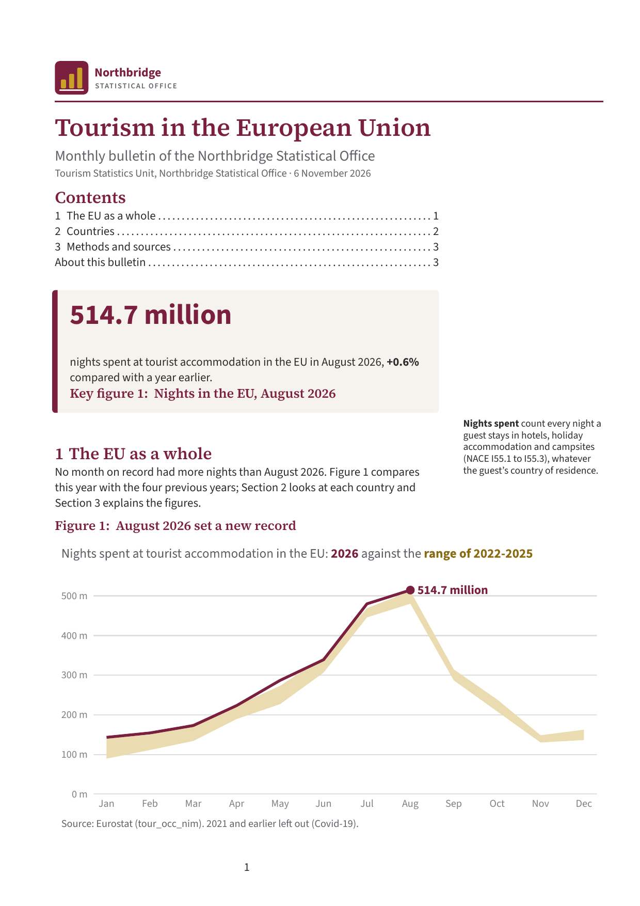
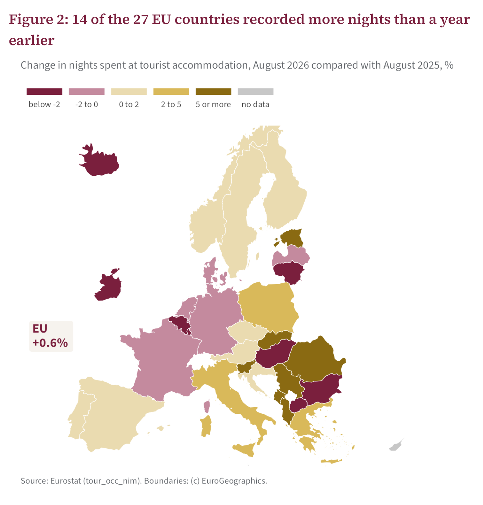
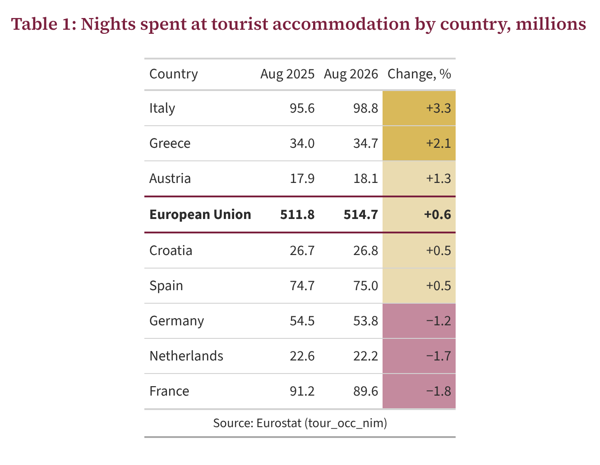
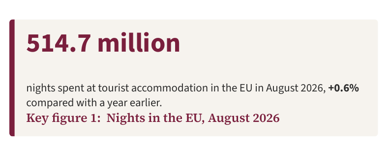
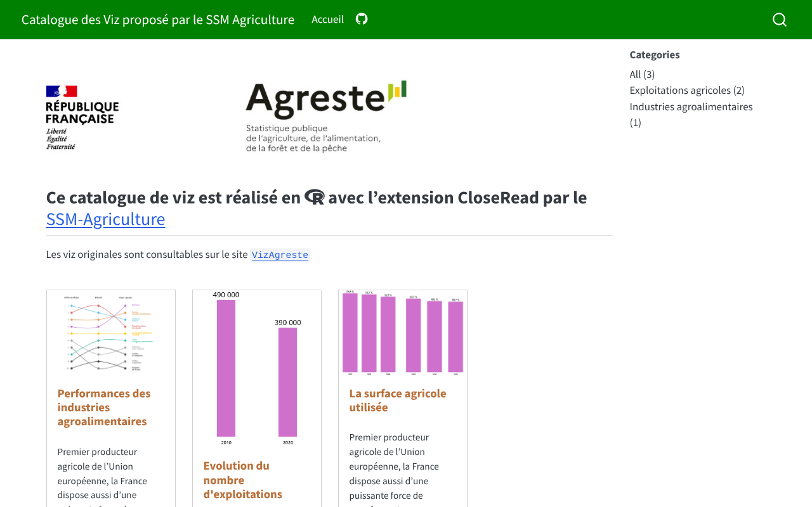
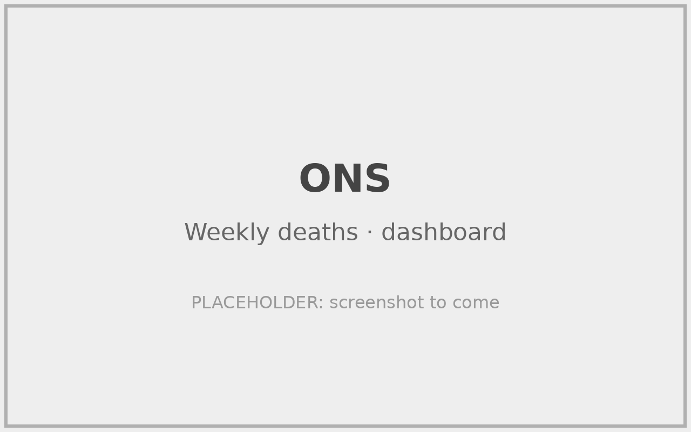
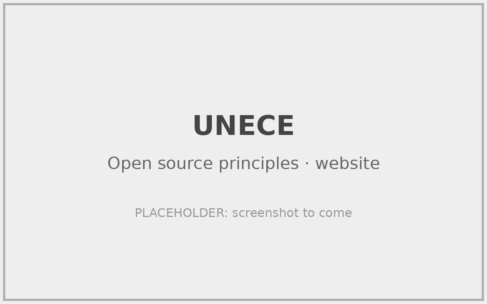
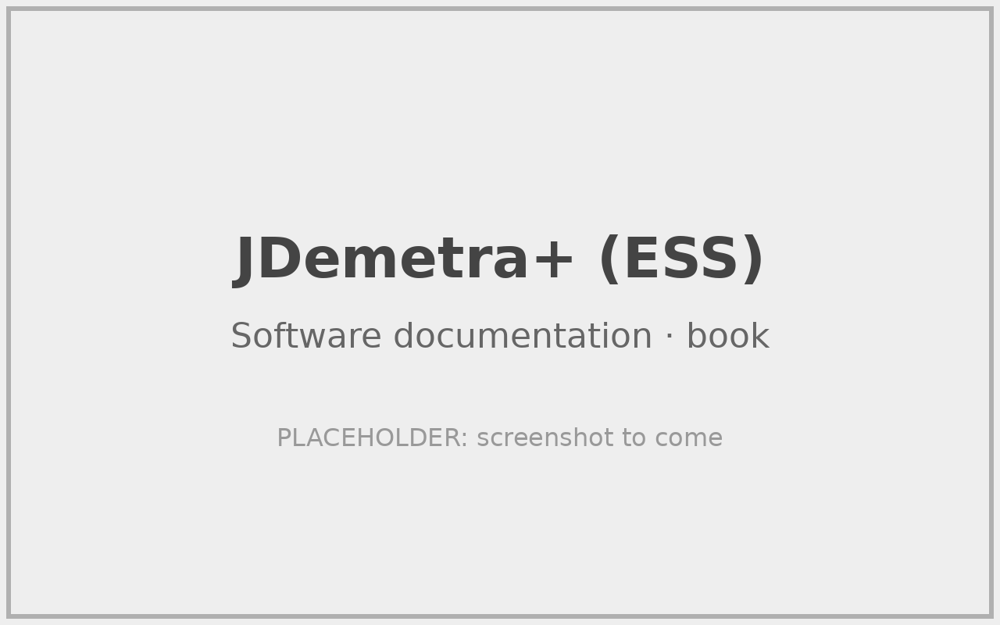

## {#title-slide .quarto-title-block .center timing-duration="10s"}

```{=html}
<h1 class='title'>Reproducible Statistical Publications with Quarto</h1>
```

{.absolute bottom='60px' right='100px' width='220px' fig-alt="uRos 2026 logo: a pink hexagon with the Eiffel Tower and an R flag, urosconf.org"}

::: {.quarto-title-authors}
::: {.quarto-title-author}
::: {.quarto-title-author-name}
Christophe Dervieux
`<p class="quarto-title-affiliation">Posit PBC</p>`{=html}
:::
:::
:::



<!--
STORYBOARD, low fidelity. Rhythm, titles, scripted lines and transitions are real;
boxes with a dashed border (.ph) are placeholders for screenshots of the example
repository; code marked "draft" will be replaced by the code of that repository.
Timing (timing-duration) follows the timed outline: intro 2:00, X1 2:30, X2 1:45,
X3 1:45, Y 1:30, Z 2:30, end 0:30 = 12:30, with 2 min of margin.
-->

::: notes
(No words on the title. Walk to the centre, wait, then start with the story.)
:::

<!-- ============================ INTRO (2:00) ============================ -->

## {#conversation .center auto-animate="true" auto-animate-id="opening" timing-duration="15s"}

[Friends in official statistics:]{.lead data-id="quote-who"}

[*"Quarto? Not really used in our world."*]{.statement data-id="quote"}

::: notes
Friends said it. You are an R community that publishes numbers every day: I wanted to understand.
:::

## {#publishing-needs auto-animate="true" auto-animate-id="opening" timing-duration="20s"}

[Friends in official statistics:]{.lead .quote-who-top data-id="quote-who"}

[*"Quarto? Not really used in our world."*]{.statement .quote-top data-id="quote"}

[Every uRos since 2017:\
a talk about publishing statistics]{.statement .needs-head}

::: {.needs}
[Recurring publications, automated]{.need}
[Your institute's look]{.need}
[Less manual work]{.need}
:::

[About 35 talks in 532 program items, 2014 to 2026. Method, code and data: `analysis/` in the slides repository.]{.chart-cap}

::: notes
Read every uRos program since 2014: the same three needs, often a pipeline built in-house.
Without one, the numbers leave the code: copied by hand into Word, the PDF, the web page.
Bridge: a Thursday evening.
:::

## Thursday, 17:50 {#thursday auto-animate="true" timing-duration="35s"}

[Release tomorrow. The headline number is wrong.]{.lead}

::: {.cards}
::: {.card .fragment .custom .fix .is-code data-id="card-src" fragment-index="1"}
[]{.ico} [R code]{.kind} [245.0]{.num .wrong}[514.7]{.num .right}
:::
::: {.card .fragment .custom .fix data-id="card-word" fragment-index="2"}
[]{.ico} [Word report]{.kind} [245.0]{.num .wrong}[514.7]{.num .right}
:::
::: {.card .fragment .custom .fix data-id="card-pdf" fragment-index="3"}
[]{.ico} [PDF]{.kind} [245.0]{.num .wrong}[514.7]{.num .right}
:::
::: {.card .fragment .custom .fix data-id="card-chart" fragment-index="4"}
[]{.ico} [Chart]{.kind} [245.0]{.num .wrong}[514.7]{.num .right}
:::
::: {.card .fragment .custom .fix data-id="card-web" fragment-index="5"}
[]{.ico} [Web page]{.kind} [245.0]{.num .wrong}[514.7]{.num .right}
:::
::: {.card data-id="card-press"}
[]{.ico} [Press release]{.kind} [245.0]{.num .wrong}[514.7]{.num .right}
:::
:::

::: {.fragment fragment-index="6"}
[Which one did you forget?]{.statement .question}
:::

::: notes
Thursday, ten to six. Release tomorrow. The headline number is wrong: 245.0 million nights instead of 514.7.
You fix the R code. (click) Then the Word file. (click) The PDF. (click) The chart.
(click) The web page. Done? Hands up if you know this evening...
(click) Which one did you forget?
:::

## Thursday, 17:50 {#one-source auto-animate="true" timing-duration="15s"}

::: {.cards-fan}
::: {.card .is-blank .is-code data-id="card-src"}
[]{.ico} [One source]{.kind} 
:::

::: {.cards}
::: {.card .is-blank data-id="card-word"}
[]{.ico} [Word report]{.kind} 
:::
::: {.card .is-blank data-id="card-pdf"}
[]{.ico} [PDF]{.kind} 
:::
::: {.card .is-blank data-id="card-chart"}
[]{.ico} [Chart]{.kind} 
:::
::: {.card .is-blank data-id="card-web"}
[]{.ico} [Web page]{.kind} 
:::
::: {.card .is-blank data-id="card-press"}
[]{.ico} [Press release]{.kind} 
:::
:::
:::

[What if you only had to fix it [once]{.hl}?]{.statement}

::: notes
What if you only had to fix it once?
(Do not answer. Pause. Then: "Let me show you with a real publication.")
:::

<!-- ============================ X1 (2:30) ============================ -->

## Quarto renders text and R code into this bulletin {#rendered auto-animate="true" auto-animate-id="result" .timing-section timing-title="X1 · Every number computed" timing-duration="10s"}

::: {.shots-v data-id="result-shots"}
{.shot width="560px" fig-alt="Key figure box of the HTML bulletin: 514.7 million nights spent at tourist accommodation in the EU in August 2026, +0.6% compared with a year earlier."}

{.shot height="370px" fig-alt="Figure 1 of the HTML bulletin, August 2026 set a new record: line chart of monthly nights in the EU, the 2026 line above the range of 2022-2025, with August labelled 514.7 million."}
:::

::: notes
First time the name is said. Quarto: your text and your R code in one file, rendered to this page.
:::

## Quarto renders text and R code into this bulletin {#rendered-walk auto-animate="true" auto-animate-id="result" timing-duration="20s"}

::: {.columns}
::: {.column width="58%"}
::: {.shots-v data-id="result-shots"}
{.shot width="500px" fig-alt="Key figure box of the HTML bulletin: 514.7 million nights spent at tourist accommodation in the EU in August 2026, +0.6% compared with a year earlier."}

{.shot height="300px" fig-alt="Figure 1 of the HTML bulletin, August 2026 set a new record: line chart of monthly nights in the EU, the 2026 line above the range of 2022-2025, with August labelled 514.7 million."}
:::
:::
::: {.column width="42%" .side-steps}
[bulletin.html, August 2026]{.k}

[Key figure: 514.7 million nights]{.fragment}

[Chart and caption: from the same R code]{.fragment}

[Nobody typed 514.7]{.fragment}
:::
:::

::: notes
Point at 514.7 in the box, then in the chart.
Bridge: "Let's open the source file."
:::

## The R code you already have {#r-code .magic-move .tall-code timing-duration="30s"}

```r
library(eurostat)
library(ggplot2)

nights <- get_eurostat("tour_occ_nim",
  filters = list(geo = "EU27_2020", unit = "NR",
                 nace_r2 = "I551-I553", c_resid = "TOTAL"))
nights <- na.omit(nights)
latest <- nights[which.max(nights$time), ]

ggplot(nights, aes(time, values)) + geom_line()
```

::: notes
Here is a monthly tourism bulletin. It starts with the R code you already have:
get the data from Eurostat, take the latest month, draw the chart.
Everything that works in R works in Quarto: your packages, your charts, your tables, your models.
Nothing to rewrite.
:::

## Put it in code cells {#cells .magic-move .tall-code timing-duration="20s"}

```` markdown
```{r}
library(eurostat)
library(ggplot2)
nights <- get_eurostat("tour_occ_nim",
  filters = list(geo = "EU27_2020", unit = "NR",
                 nace_r2 = "I551-I553", c_resid = "TOTAL"))
nights <- na.omit(nights)
latest <- nights[which.max(nights$time), ]
```

```{r}
ggplot(nights, aes(time, values)) + geom_line()
```
````

::: notes
Step one: put that code in code cells, in a plain text file, a .qmd.
:::

## Write the text around it {#text .magic-move .tall-code timing-duration="25s"}

```` markdown
```{r}
library(eurostat)
library(ggplot2)
nights <- get_eurostat("tour_occ_nim",
  filters = list(geo = "EU27_2020", unit = "NR",
                 nace_r2 = "I551-I553", c_resid = "TOTAL"))
nights <- na.omit(nights)
latest <- nights[which.max(nights$time), ]
```

Nights spent in tourist accommodation, EU, by month:

```{r}
ggplot(nights, aes(time, values)) + geom_line()
```
````

::: notes
Step two: write your text around the code, in plain Markdown.
The comment, the method note: they live next to the code that makes the numbers.
:::

## Tell Quarto what each cell is {#options .magic-move .tall-code timing-duration="25s"}

```` markdown
```{r}
#| echo: false
library(eurostat)
library(ggplot2)
nights <- get_eurostat("tour_occ_nim",
  filters = list(geo = "EU27_2020", unit = "NR",
                 nace_r2 = "I551-I553", c_resid = "TOTAL"))
nights <- na.omit(nights)
latest <- nights[which.max(nights$time), ]
```

Nights spent in tourist accommodation, EU, by month:

```{r}
#| label: fig-trend
#| fig-cap: "Nights spent at tourist accommodation, EU"
ggplot(nights, aes(time, values)) + geom_line()
```
````

::: notes
Step three: options on each cell. Hide the code from the reader. Give the chart a label and a caption.
:::

## Put the number in the sentence {#inline .magic-move .tall-code timing-duration="25s"}

```` markdown
```{r}
#| echo: false
library(eurostat)
library(ggplot2)
nights <- get_eurostat("tour_occ_nim",
  filters = list(geo = "EU27_2020", unit = "NR",
                 nace_r2 = "I551-I553", c_resid = "TOTAL"))
nights <- na.omit(nights)
latest <- nights[which.max(nights$time), ]
```

The EU recorded `r round(latest$values / 1e6, 1)` million nights.

```{r}
#| label: fig-trend
#| fig-cap: "Nights spent at tourist accommodation, EU"
ggplot(nights, aes(time, values)) + geom_line()
```
````

::: notes
Step four, the important one: the number in the sentence is not typed. It is computed.
:::

<!-- ============================ X2 (1:45) ============================ -->

## One header, every format {#formats .magic-move .timing-section timing-title="X2 · One source" timing-duration="10s"}

```yaml
---
title: "Tourism in the EU"
format: html
---
```

::: notes
The formats are one line each, in the header of the same file.
HTML for the web.
:::

## One header, every format {#formats-pdf .magic-move timing-duration="10s"}

```yaml
---
title: "Tourism in the EU"
format:
  html: default
  typst: default
---
```

::: notes
Typst for the PDF: print-ready, and no LaTeX to install or learn.
:::

## One header, every format {#formats-docx .magic-move timing-duration="15s"}

```yaml
---
title: "Tourism in the EU"
format:
  html: default
  typst: default
  docx: default
---
```

`quarto render bulletin.qmd` → `bulletin.html` · `bulletin.pdf` · `bulletin.docx`

::: notes
Word, for the colleague who wants Word.
One command renders all of them.
:::

## For the web {#html timing-duration="25s"}

{.shot height="530px" fig-align="center" fig-alt="Top of the HTML bulletin in a browser: the Northbridge Statistical Office banner with its logo, the title Tourism in the European Union, a contents sidebar with links to the PDF and Word versions, and the key figure 514.7 million in a box."}

::: notes
For the web: an accessible HTML page, readable on a phone, the chart and the table inside.
:::

## For print {#pdf timing-duration="25s"}

{.shot height="540px" fig-align="center" fig-alt="Page 1 of the PDF bulletin: the logo, the title, the contents, the key figure 514.7 million in a box, and Figure 1, the line chart of nights in 2026 against the 2022-2025 range."}

::: notes
For print and for the archive: the PDF. Same text, same numbers, same chart. From the same file.
:::

## Each format for its reader {#each-reader timing-duration="20s"}

::: {.carousel-live}
```{.carousel #formats-carousel autoplay="3500" effect="scale" slides="1" height="470px" loop="false" dots="false" arrows="false" fragment="false"}




```
:::

::: {.print-only}
::: {.columns}
::: {.column width="60%"}
{.shot fig-alt="Top of the HTML bulletin in a browser: the Northbridge Statistical Office banner with its logo, the title Tourism in the European Union, a contents sidebar with links to the PDF and Word versions, and the key figure 514.7 million in a box."}
:::
::: {.column width="40%"}
{.shot height="520px" fig-alt="Page 1 of the PDF bulletin: the logo, the title, the contents, the key figure 514.7 million in a box, and Figure 1, the line chart of nights in 2026 against the 2022-2025 range."}
:::
:::
:::

::: notes
The web reader and the print reader each get the format they need, from one file,
and they all read the same numbers. (Word too, if a colleague asks for it.)
:::

<!-- ============================ X3 (1:45) ============================ -->

## Tables ready to publish {#table .timing-section timing-title="X3 · Ready to publish" timing-duration="35s"}

::: {.columns}
::: {.column width="55%"}
```` markdown
```{r}
#| label: tbl-countries
#| tbl-cap: "Nights by country, millions"
gt(tab) |>
  fmt_number(columns = c(before, now),
             scale_by = 1e-6, decimals = 1) |>
  fmt_number(columns = change, decimals = 1,
             force_sign = TRUE)
```
````
:::
::: {.column width="45%"}
::: {.r-stack}
{.shot .fragment .fade-out .print-hide fragment-index="1" width="500px" fig-alt="Table 1 in the HTML bulletin: nights by country in August 2025 and August 2026 and the change in %, the EU row in bold between burgundy rules, the change cells coloured from gold for rises to pink for falls."}

{.shot .fragment fragment-index="1" width="500px" fig-alt="The same Table 1 in the PDF bulletin, with the same numbers, rules and colours."}
:::
:::
:::

::: notes
Publications are tables. Your R table package, gt or another one, renders the table in HTML and in PDF.
The label and caption make it Table 1, numbered for you.
:::

## Captions and cross-references {#crossref timing-duration="25s"}

```markdown
@fig-trend compares this year
with the four previous years;
@sec-countries looks at each country
and @sec-methods explains the figures.
```

{.shot width="1100px" fig-align="center" fig-alt="The sentence in the HTML bulletin, with links: Figure 1 compares this year with the four previous years; Section 2 looks at each country and Section 3 explains the figures."}

::: notes
Write \@fig-trend in your text and Quarto writes "Figure 1", with a link in HTML;
\@sec-countries becomes "Section 2". Add a figure or a section, the numbers follow.
No more "see Table 3" pointing to the old Table 3.
:::

## Your institute's look {#brand timing-duration="25s"}

::: {.columns}
::: {.column width="45%"}
```{.yaml filename="_brand.yml"}
meta:
  name: Northbridge Statistical Office
logo:
  images:
    mark: brand/nso-mark.svg
color:
  primary: "#7a1f3d"
typography:
  base: Source Sans 3
  headings: Source Serif 4
```
:::
::: {.column width="55%"}
::: {.shot-pair}
{.shot .pair-back fig-alt="The HTML bulletin in the institute's colours: a stone banner, the burgundy logo and title in Source Serif 4, body text in Source Sans 3."}

{.shot .pair-front fig-alt="Page 1 of the PDF bulletin laid over it, with the same logo, colours and fonts."}
:::
:::
:::

::: notes
And your institute's look: colours, logo, fonts, written once in _brand.yml.
HTML, PDF, even these slides pick it up. Here, a fictional institute.
:::

## Accessible PDF, checked {#pdf-ua timing-duration="20s"}

```{.yaml filename="_quarto.yml"}
format:
  typst:
    pdf-standard: [a-2b, ua-1]
```

```{.bash}
$ quarto render bulletin.qmd
[verapdf]: Validating bulletin.pdf against PDF/2B... PASSED
[verapdf]: Validating bulletin.pdf against PDF/UA1... PASSED
```

[Docs: [quarto.org/docs/output-formats/typst.html#pdf-accessibility-standards](https://quarto.org/docs/output-formats/typst.html#pdf-accessibility-standards)]{.small-cap}

::: notes
Your PDF must be accessible too, and archived. One line asks for both: PDF/A for the archive,
PDF/UA for a tagged PDF that screen readers can follow. With veraPDF installed, Quarto checks them at every render.
:::

<!-- ============================ Y (1:30) ============================ -->

## Thursday, 17:50. Again. {#again .timing-section timing-title="Y · Fix it once" timing-duration="30s"}

[The headline number is wrong.]{.lead}

::: {.magic-move .print-hide}

```r
nights <- get_eurostat("tour_occ_nim",
  filters = list(geo = "EU27_2020", unit = "NR",
                 nace_r2 = "I551-I553", c_resid = "FOR"))
```

```r
nights <- get_eurostat("tour_occ_nim",
  filters = list(geo = "EU27_2020", unit = "NR",
                 nace_r2 = "I551-I553", c_resid = "TOTAL"))
```

:::

<!-- PDF export: the magic-move above is captured mid-animation, show its final state instead -->
::: {.print-only}
```r
nights <- get_eurostat("tour_occ_nim",
  filters = list(geo = "EU27_2020", unit = "NR",
                 nace_r2 = "I551-I553", c_resid = "TOTAL"))
```
:::

::: notes
Back to Thursday, ten to six. The headline number is wrong, again.
Someone kept the foreign guests only. You fix the R code: one line, one word.
:::

## One render {#one-render timing-duration="35s"}

`quarto render bulletin.qmd`

::: {.columns}
::: {.column width="50%"}
::: {.hl-shot}
{.shot fig-alt="Key figure box of the HTML bulletin: 514.7 million nights spent at tourist accommodation in the EU in August 2026, +0.6% compared with a year earlier."}

[]{.hl-box .fragment fragment-index="1" style="left: 3.5%; top: 9%; width: 42%; height: 28%;"}
:::
[bulletin.html]{.shot-label}
:::
::: {.column width="50%"}
::: {.hl-shot}
{.shot fig-alt="The same key figure box in the PDF bulletin: 514.7 million nights in August 2026, +0.6% compared with a year earlier."}

[]{.hl-box .fragment fragment-index="1" style="left: 4%; top: 13%; width: 46%; height: 30%;"}
:::
[bulletin.pdf]{.shot-label}
:::
:::

::: notes
One render. The table, the sentence, the chart, the HTML, the PDF, the Word file:
the same corrected number, everywhere.
:::

## Thursday, 17:51 {#none timing-duration="25s"}

::: {.cards-fan}
::: {.card .is-right .is-code data-id="card-src"}
[]{.ico} [One source]{.kind} [245.0]{.num .wrong}[514.7]{.num .right}
:::

::: {.cards}
::: {.card .is-right data-id="card-word"}
[]{.ico} [Word report]{.kind} [245.0]{.num .wrong}[514.7]{.num .right}
:::
::: {.card .is-right data-id="card-pdf"}
[]{.ico} [PDF]{.kind} [245.0]{.num .wrong}[514.7]{.num .right}
:::
::: {.card .is-right data-id="card-chart"}
[]{.ico} [Chart]{.kind} [245.0]{.num .wrong}[514.7]{.num .right}
:::
::: {.card .is-right data-id="card-web"}
[]{.ico} [Web page]{.kind} [245.0]{.num .wrong}[514.7]{.num .right}
:::
::: {.card .is-right data-id="card-press"}
[]{.ico} [Press release]{.kind} [245.0]{.num .wrong}[514.7]{.num .right}
:::
:::
:::

[Fix it once. Render. Which one did you forget? [None.]{.payoff .fragment}]{.payoff-line}

::: notes
Thursday, 17:51. Fix it once. Render. Which one did you forget?
(Pause.)
None.
:::

<!-- ============================ Z (2:30) ============================ -->

## Already published with Quarto {#products .timing-section timing-title="Z · And next" timing-duration="50s"}

[France · Norway · United Kingdom · international bodies]{.gallery-count}

<!-- Screenshots: just gallery (scripts/capture-gallery.mjs), which also checks each page is made with Quarto -->

::: {.r-stack}
::: {.gallery-live .fragment .fade-out fragment-index="1"}
```{.carousel #gallery autoplay="5000" effect="scale" slides="1" height="390px" loop="false" dots="false" arrows="false" fragment="false"}







```
:::

::: {.gallery-grid .fragment fragment-index="1"}
[{fig-alt="Top of the page: Insee: working paper, HTML + PDF, made with Quarto"}](https://inseefrlab.github.io/DT-tvcoef/)
[{fig-alt="Top of the page: Agreste (SSM Agriculture): dataviz catalogue, made with Quarto"}](https://ssm-agriculture.github.io/site-DataViz/)
[{fig-alt="Top of the page: ONS: weekly deaths data explorer (prototype), made with Quarto"}](https://onsdigital.github.io/weekly_deaths_data_explorer/)
[{fig-alt="Top of the page: NISRA: Childcare Survey 2024 results, made with Quarto"}](https://nisra-explore.github.io/childcare-survey/)
[{fig-alt="Top of the page: Statistics Norway: documentation report with an ISBN, made with Quarto"}](https://doc.ameld.ssb.no/)
[{fig-alt="Top of the page: OECD: Regional Outlook 2023 country profiles, made with Quarto"}](https://oecd-cfe-eds.github.io/ro2023-country-pages/)
[{fig-alt="Top of the page: UNECE HLG-MOS: open source principles, made with Quarto"}](https://unece.github.io/OSS/)
[{fig-alt="Top of the page: JDemetra+: software documentation, made with Quarto"}](https://jdemetra-new-documentation.netlify.app/)
:::
:::

::: {.fragment fragment-index="2"}
[These slides are Quarto too.]{.lead}
:::

::: notes
These are already published with Quarto, in official statistics: a working paper at Insee, in HTML and PDF from one source; a dataviz catalogue at Agreste; dashboards at the ONS; a survey report at NISRA; documentation at Statistics Norway; the OECD, UNECE, JDemetra+...
Some of you are already in this picture. This is a map, not a ranking.
(click: the grid) (click) And these slides are Quarto too.
:::

## {#number-people-read .center timing-duration="25s"}

[The number people read\
is the number [your code produced]{.hl}.]{.statement}

::: notes
That is what reproducible means for a publication:
the number people read is the number your code produced.
:::

## {#next-year .center timing-duration="35s"}

[Every year, a talk about publishing statistics.]{.lead}

. . .

[Next year, make it [one of yours]{.hl}.]{.statement}

::: notes
Every year since 2017, someone here talked about publishing statistics.
Next year, make it one of yours: show us what you published, from one source.
:::

## {#closing .center timing-duration="40s"}

::: {.incremental .closing-lines}
- You already do R.
- You already publish.
- Quarto makes it [reproducible]{.hl}, from [one source]{.hl}, [ready to publish]{.hl}.
:::

::: notes
You already do R. You already publish.
Quarto makes it reproducible, from one source, ready to publish.
Thank you.
:::

<!-- ============================ END (0:30) ============================ -->

## Learning More {#learning-more .smaller .timing-section timing-title="End" timing-duration="30s"}

::: {.columns}
::: {.column width="62%"}
#### Slides: <https://cderv.github.io/uros2026-quarto-intro/> {.bottom-pad}

#### Example: [https://github.com/cderv/EXAMPLE-REPO]{.draft-inline} {.bottom-pad}

- Getting started: <https://quarto.org/docs/get-started/>
- User guide: <https://quarto.org/docs/guide/>
- Gallery: <https://quarto.org/docs/gallery/>
- Awesome Quarto: <https://github.com/mcanouil/awesome-quarto>

#### Questions? {.top-pad}
:::
::: {.column width="38%"}
::: {.qr-block}


Slides
:::
:::
:::

::: notes
The slides and the example bulletin are online: take a picture of the QR code.
Questions?
:::
