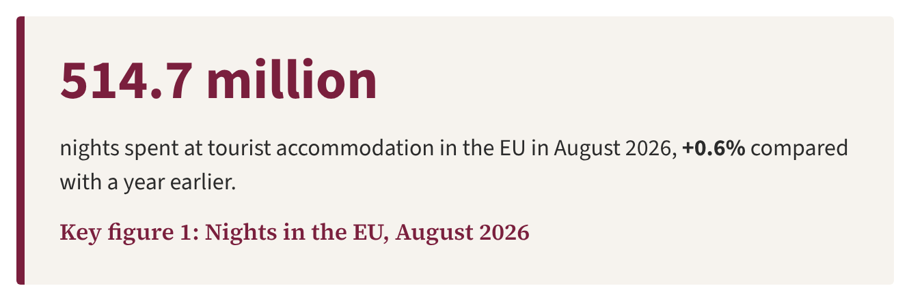
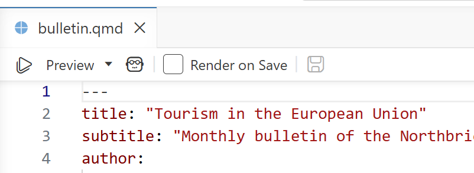
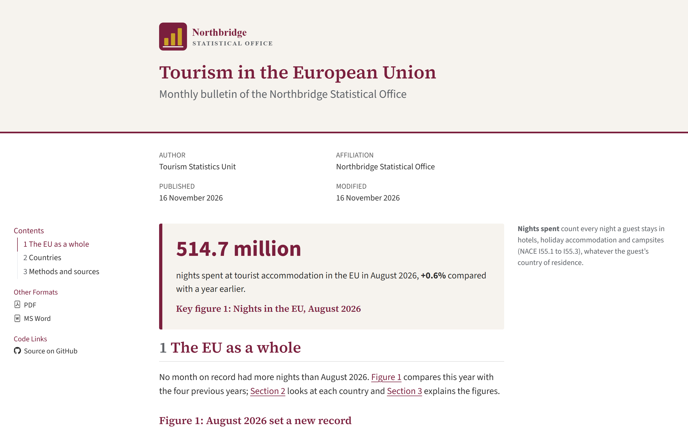
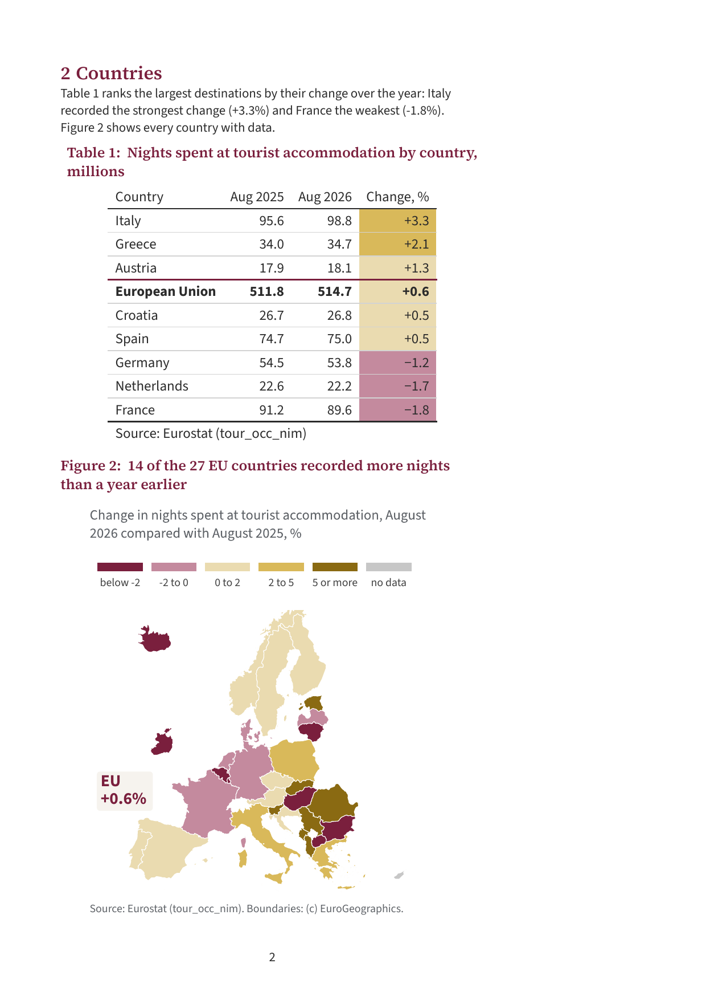
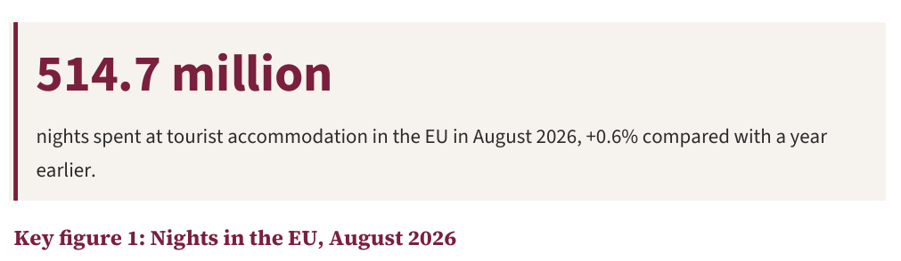
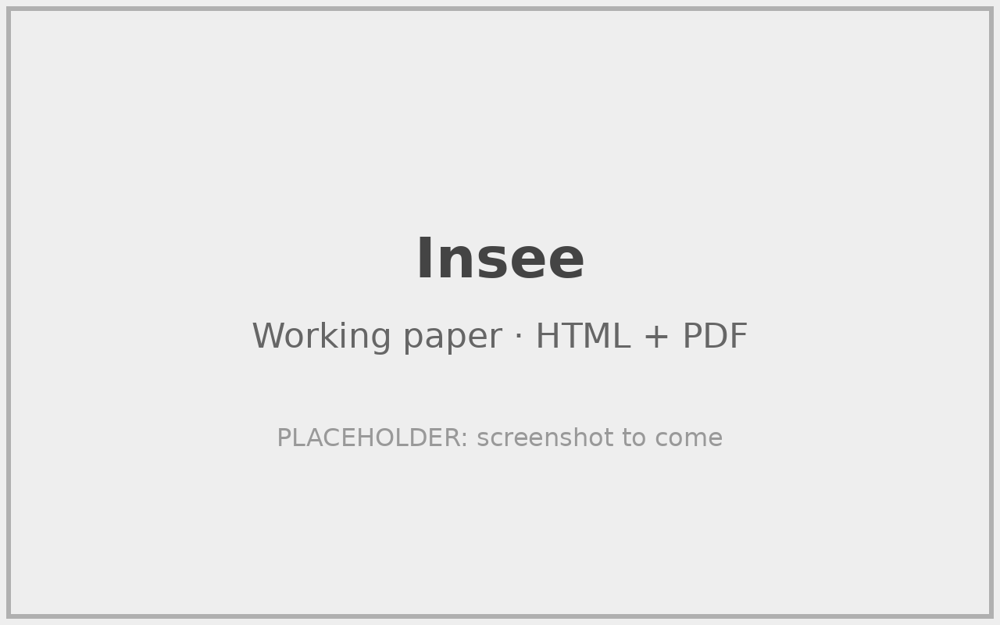
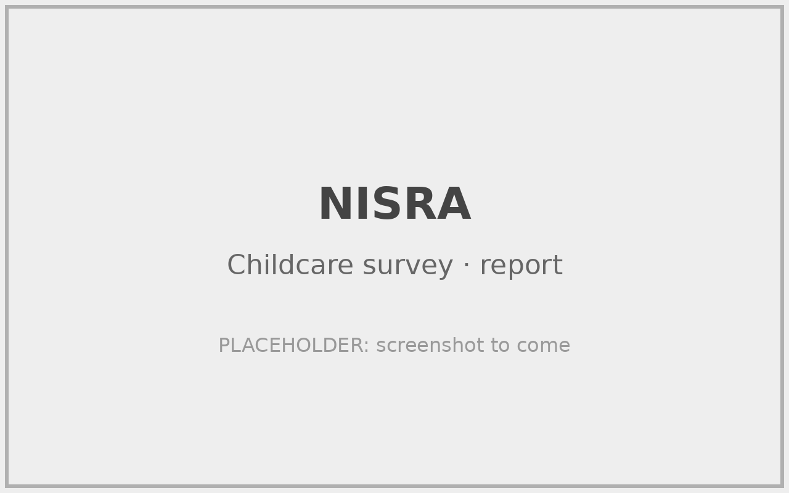
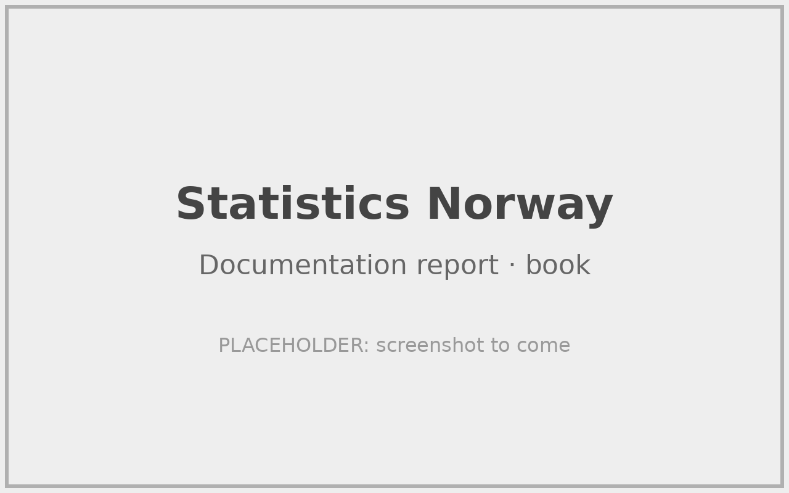

## {#title-slide .quarto-title-block .center timing-duration="10s"}

<!-- fmt: skip file -->

```{=html}
<h1 class='title'>Reproducible Statistical Publications with Quarto</h1>
```

{
  .absolute bottom='60px' right='100px' width='220px' fig-alt="uRos 2026 logo: a pink hexagon with the Eiffel Tower and an R flag, urosconf.org"
}

::: {.quarto-title-authors}
::: {.quarto-title-author}
::: {.quarto-title-author-name}
Christophe Dervieux
`<p class="quarto-title-affiliation">Posit PBC</p>`{=html}
:::
:::
:::



::: notes
Welcome everyone. Why here: I work on Quarto at Posit, and this room
publishes numbers with R every day.
:::

<!-- ============================ INTRO (1:35) ============================ -->

## {#conversation .center timing-duration="15s"}

[Friends in official statistics:]{.lead}

[*"Quarto? I haven't seen it used much in official statistics."*]{.statement}

::: notes
Friends said it. I wanted to understand why.
:::

## {#publishing-needs timing-duration="20s"}

[Friends in official statistics:]{.lead .quote-who-top}

[*"Quarto? I haven't seen it used much in official statistics."*]{.statement .quote-top}

[Every uRos since 2017\
has a talk about publishing statistics]{.statement .needs-head}

::: {.needs}
[Recurring publications, automated]{.need}
[Your institute's look]{.need} [Less manual work]{.need}
:::

[Programs read from 2014 to 2026: 532 items, about 35 publishing talks. Method, code and data: `analysis/` in the slides repository.]{.chart-cap}

::: notes
I read every uRos program since 2014. The same three needs come back,
often with a pipeline built in-house. Without one, someone copies the
numbers by hand into Word, the PDF, the web page. Bridge: a Thursday
evening.
:::

## Thursday, 17:50 {#thursday auto-animate="true" timing-duration="35s"}

[The key figure is wrong, and the release is tomorrow.]{.lead}

::: {.cards}
::: {.card .fragment .custom .fix .is-code data-id="card-src" fragment-index="1"}
[]{.ico} [R code]{.kind}
[245.0]{.num .wrong}[514.7]{.num .right}
:::

::: {.card .fragment .custom .fix data-id="card-word" fragment-index="2"}
[]{.ico} [Word report]{.kind}
[245.0]{.num .wrong}[514.7]{.num .right}
:::

::: {.card .fragment .custom .fix data-id="card-pdf" fragment-index="3"}
[]{.ico} [PDF]{.kind}
[245.0]{.num .wrong}[514.7]{.num .right}
:::

::: {.card .fragment .custom .fix data-id="card-chart" fragment-index="4"}
[]{.ico} [Chart]{.kind}
[245.0]{.num .wrong}[514.7]{.num .right}
:::

::: {.card .fragment .custom .fix data-id="card-web" fragment-index="5"}
[]{.ico} [Web page]{.kind}
[245.0]{.num .wrong}[514.7]{.num .right}
:::

::: {.card data-id="card-press"}
[]{.ico}
[Press release]{.kind} [245.0]{.num .wrong}[514.7]{.num .right}
:::
:::

::: {.fragment fragment-index="6"}
[One is still wrong.]{.statement .question}
:::

::: notes
245.0 instead of 514.7. One fix per click: R code (1), Word (2), PDF
(3), chart (4), web page (5). (6) Press release still red.
:::

## Thursday, 17:50 {#one-source auto-animate="true" timing-duration="15s"}

::: {.cards-fan}
::: {.card .is-blank .is-code data-id="card-src"}
[]{.ico}
[One source file]{.kind}
:::

::: {.cards}
::: {.card .is-blank data-id="card-word"}
[]{.ico} [Word report]{.kind}
:::

::: {.card .is-blank data-id="card-pdf"}
[]{.ico} [PDF]{.kind}
:::

::: {.card .is-blank data-id="card-chart"}
[]{.ico} [Chart]{.kind}
:::

::: {.card .is-blank data-id="card-web"}
[]{.ico} [Web page]{.kind}
:::

::: {.card .is-blank data-id="card-press"}
[]{.ico}
[Press release]{.kind}
:::
:::
:::

[Fix it [once]{.hl}]{.statement}

::: notes
Bridge: "The tool for this is Quarto."
:::

<!-- ============================ X1 (2:25) ============================ -->

## Quarto ... {#what-is-quarto .timing-section timing-title="X1 · Every number computed" timing-duration="15s"}

...is an open-source, scientific, and technical publishing system

![[Artwork from "Hello, Quarto" keynote by Julia Lowndes and Mine Çetinkaya-Rundel, presented at RStudio Conference 2022. Illustrated by Allison Horst.]{.small-cap}](images/horst_quarto_schematic.png){
  width="900px" fig-align="center" fig-alt="Schematic: R, Python, Observable, Julia and other languages go into Quarto, which makes HTML, PDF, Word and other documents."
}

::: notes
If you know R Markdown, same idea. For you, R on the left. On the right,
the documents from Thursday. Bridge: "One example for the rest of the
talk, a statistical bulletin."
:::

## Quarto renders text and R code into this bulletin {#rendered kicker="Every number computed" auto-animate="true" auto-animate-id="result" timing-duration="10s"}

::: {.shots-v}
{
  .shot width="560px" fig-alt="Key figure box of the HTML bulletin: 514.7 million nights spent at tourist accommodation in the EU in August 2026, +0.6% compared with a year earlier."
}

{
  .shot height="370px" fig-alt="Figure 1 of the HTML bulletin, titled 'August 2026 set a new record'. Line chart of monthly nights in the EU, the 2026 line above the 2022-2025 range, August labelled 514.7 million."
}
:::

::: notes
Monthly bulletin, Eurostat tourism data.
:::

## Quarto renders text and R code into this bulletin {#rendered-walk kicker="Every number computed" auto-animate="true" auto-animate-id="result" timing-duration="20s"}

::: {.columns}
::: {.column width="58%"}
::: {.shots-v}
{
  .shot width="500px" fig-alt="Key figure box of the HTML bulletin: 514.7 million nights spent at tourist accommodation in the EU in August 2026, +0.6% compared with a year earlier."
}

{
  .shot height="300px" fig-alt="Figure 1 of the HTML bulletin, titled 'August 2026 set a new record'. Line chart of monthly nights in the EU, the 2026 line above the 2022-2025 range, August labelled 514.7 million."
}
:::
:::

::: {.column width="42%" .side-steps}
[bulletin.html, August 2026]{.k}

[Key figure: 514.7 million nights]{.fragment}

[Chart and caption come from the same R code]{.fragment}

[Nobody typed 514.7]{.fragment}
:::
:::

::: notes
Point at 514.7 in the box, then in the chart. Bridge: "Let's open the
source file."
:::

## The R code you already have {#r-code kicker="Every number computed" .magic-move .tall-code timing-duration="15s"}

```r
library(eurostat)
library(ggplot2)

nights <- get_eurostat(
  "tour_occ_nim",
  filters = list(
    geo = "EU27_2020",
    unit = "NR",
    nace_r2 = "I551-I553",
    c_resid = "TOTAL"
  )
)
nights <- na.omit(nights)
latest <- nights[which.max(nights$time), ]

ggplot(nights, aes(time, values)) + geom_line()
```

[Shortened for the slide. Full source in [cderv/uros2026-quarto-example](https://github.com/cderv/uros2026-quarto-example).]{.chart-cap}

::: notes
Eurostat data, latest month, one chart. Your R code and packages stay as
they are.
:::

## Put it in code cells, write the text around them {#cells-text kicker="Every number computed" .magic-move .tall-code timing-duration="25s"}

````{.markdown code-line-numbers="1,15,17,19,21"}
```{r}
library(eurostat)
library(ggplot2)
nights <- get_eurostat(
  "tour_occ_nim",
  filters = list(
    geo = "EU27_2020",
    unit = "NR",
    nace_r2 = "I551-I553",
    c_resid = "TOTAL"
  )
)
nights <- na.omit(nights)
latest <- nights[which.max(nights$time), ]
```

Nights spent in tourist accommodation, EU, by month:

```{r}
ggplot(nights, aes(time, values)) + geom_line()
```
````

[A .qmd file is plain text. R code in code cells, your text in Markdown between them.]{.chart-cap}

::: notes
The comment and the method note live next to the code that makes the
numbers.
:::

## Tell Quarto what each cell is {#options kicker="Every number computed" .magic-move .tall-code timing-duration="20s"}

````{.markdown code-line-numbers="2,21,22"}
```{r}
#| echo: false
library(eurostat)
library(ggplot2)
nights <- get_eurostat(
  "tour_occ_nim",
  filters = list(
    geo = "EU27_2020",
    unit = "NR",
    nace_r2 = "I551-I553",
    c_resid = "TOTAL"
  )
)
nights <- na.omit(nights)
latest <- nights[which.max(nights$time), ]
```

Nights spent in tourist accommodation, EU, by month:

```{r}
#| label: fig-trend
#| fig-cap: "Nights spent at tourist accommodation, EU"
ggplot(nights, aes(time, values)) + geom_line()
```
````

::: notes
`#|` lines are options for Quarto. Hide the code, name and caption the
chart (the "Figure 1" you saw).
:::

## Write R code inside the sentence {#inline kicker="Every number computed" .magic-move .tall-code timing-duration="25s"}

````{.markdown code-line-numbers="18"}
```{r}
#| echo: false
library(eurostat)
library(ggplot2)
nights <- get_eurostat(
  "tour_occ_nim",
  filters = list(
    geo = "EU27_2020",
    unit = "NR",
    nace_r2 = "I551-I553",
    c_resid = "TOTAL"
  )
)
nights <- na.omit(nights)
latest <- nights[which.max(nights$time), ]
```

The EU recorded `{r} round(latest$values / 1e6, 1)` million nights.

```{r}
#| label: fig-trend
#| fig-cap: "Nights spent at tourist accommodation, EU"
ggplot(nights, aes(time, values)) + geom_line()
```
````

::: notes
R computes 514.7 at render. The sentence updates with new data.
:::

## Quarto is a command line tool (CLI) {#render-cli kicker="Every number computed" timing-duration="15s"}

```bash
quarto render bulletin.qmd
```

::: {.fragment}
[Or one button in {.tool-logo fig-alt="Positron logo"} Positron, {.tool-logo fig-alt="RStudio logo"} RStudio, {.tool-logo fig-alt="VS Code logo"} VS Code]{.lead}

::: {.columns}
::: {.column width="50%"}
<!-- screenshots and frame positions: just ide-captures (scripts/capture-ide.sh) -->
::: {.hl-shot}
{
  .shot fig-alt="Top of the Positron editor with bulletin.qmd open: the
tab, the toolbar with the Preview button, and the first lines of the
YAML header."
}

[]{.hl-box style="left: 0.7%; top: 27.7%; width: 25.7%; height: 19.0%;"}
:::

[Positron]{.shot-label}
:::

::: {.column width="50%"}
::: {.hl-shot}
{
  .shot fig-alt="Top of the RStudio editor with bulletin.qmd open: the
tab, the toolbar with the Render button, and the first lines of the
YAML header."
}

[]{.hl-box style="left: 63.1%; top: 18.7%; width: 15.7%; height: 16.5%;"}
:::

[RStudio]{.shot-label}
:::
:::

:::


::: notes
With one command, R computes the numbers and Quarto writes the page.
Free to install. (click) Comes with Positron (Preview button) and
RStudio (Render button). In VS Code, install one extension. Bridge: same
command, more formats.
:::

<!-- ============================ X2 (1:20) ============================ -->

## Output formats at the top of the file {#formats kicker="Same source, multiple formats" .magic-move .timing-section timing-title="X2 · Same source, multiple formats" timing-duration="10s"}

```{.yaml code-line-numbers="3"}
---
title: Tourism in the EU
format: html
---
```

::: notes
Same file. This block at the top is the YAML header. HTML first.
:::

## Output formats at the top of the file {#formats-pdf kicker="Same source, multiple formats" .magic-move timing-duration="15s"}

```{.yaml code-line-numbers="5"}
---
title: Tourism in the EU
format:
  html: default
  typst: default # PDF, no LaTeX to install
---
```

::: notes
Typst comes with Quarto and makes the PDF. No LaTeX.
:::

## Output formats at the top of the file {#formats-docx kicker="Same source, multiple formats" .magic-move timing-duration="15s"}

```{.yaml code-line-numbers="6"}
---
title: Tourism in the EU
format:
  html: default
  typst: default # PDF, no LaTeX to install
  docx: default
---
```

::: {.fragment}
The same command...

```bash
quarto render bulletin.qmd
```

... now writes `bulletin.html`, `bulletin.pdf` and `bulletin.docx`
:::

::: notes
Word, for the colleague who asks for Word. (click) Same command as on
the CLI slide. Bridge: the web page, then the PDF.
:::

## For the web {#html kicker="Same source, multiple formats" timing-duration="20s"}

{
  .shot height="530px" fig-align="center" fig-alt="Top of the HTML bulletin in a browser: the Northbridge Statistical Office banner with its logo, the title Tourism in the European Union, a contents sidebar with links to the PDF and Word versions, and the key figure 514.7 million in a box."
}

::: notes
The web page is readable on a phone, chart and table inside.
:::

## For print {#pdf kicker="Same source, multiple formats" timing-duration="20s"}

<!-- the two PDF pages scroll slowly while the slide is shown; the PDF export shows them side by side -->
::: {.page-scroll .print-hide .no-overflow-check}
::: {.pages}
{
  fig-alt="Page 1 of the PDF bulletin: the logo, the title, the
contents, the key figure 514.7 million in a box, and Figure 1, the line
chart of nights in 2026 against the 2022-2025 range."
}

{
  fig-alt="Page 2 of the PDF bulletin: Table 1 of nights by country and the
map of the yearly change."
}
:::
:::

::: {.print-only}
::: {.columns}
::: {.column width="50%"}
{
  .shot height="540px" fig-align="center" fig-alt="Page 1 of the PDF bulletin."
}
:::

::: {.column width="50%"}
{
  .shot height="540px" fig-align="center" fig-alt="Page 2 of the PDF bulletin."
}
:::
:::
:::

::: notes
Print and the archive, from the same file. (The pages scroll by
themselves.)
:::

<!-- ============================ X3 (1:50) ============================ -->

## A gt table in HTML and PDF {#table kicker="Ready to publish" .timing-section timing-title="X3 · Ready to publish" timing-duration="30s"}

::: {.columns}
::: {.column width="50%"}
```` markdown
```{r}
#| label: tbl-countries
#| tbl-cap: >
#|   Nights spent at tourist accommodation
#|   by country, millions
gt(tab) |>
  fmt_number(
    columns = c(before, now),
    scale_by = 1e-6,
    decimals = 1
  ) |>
  fmt_number(
    columns = change,
    decimals = 1,
    force_sign = TRUE
  )
```
````

[Shortened for the slide. Colors and the bold EU row are in the full source.]{.chart-cap}
:::

::: {.column width="50%"}
::: {.r-stack}
::: {.fragment .fade-out .print-hide fragment-index="1"}
{
  .shot width="600px" fig-alt="Table 1 in the HTML bulletin: nights by country in August 2025 and August 2026 and the change in %, the EU row in bold between burgundy lines, the change cells colored from gold for rises to pink for falls."
}

[bulletin.html]{.shot-label}
:::

::: {.fragment fragment-index="1"}
{
  .shot width="600px" fig-alt="The same Table 1 in the PDF bulletin, with the same numbers, lines and colors."
}

[bulletin.pdf]{.shot-label}
:::
:::
:::
:::

::: notes
Same gt code, one table in bulletin.html and in bulletin.pdf. Table 1
comes from label + tbl-cap, numbered for you.
:::

## Cross-references are numbered for you {#crossref kicker="Ready to publish" timing-duration="25s"}

```{.markdown .wrap-code}
No month on record had more nights than August 2026. @fig-trend compares
this year with the four previous years; @sec-countries looks at each
country and @sec-methods explains the figures.
```

{
  .shot width="1100px" fig-align="center" fig-alt="The sentence in the HTML bulletin, with links: Figure 1 compares this year with the four previous years; Section 2 looks at each country and Section 3 explains the figures."
}

<!-- frames on the @ references, positions measured on the rendered slide -->
[]{.xr-box .absolute .fragment fragment-index="1" style="left: 786px; top: 97px; width: 161px; height: 40px;"}
[]{.xr-box .absolute .fragment fragment-index="1" style="left: 594px; top: 134px; width: 221px; height: 40px;"}
[]{.xr-box .absolute .fragment fragment-index="1" style="left: 180px; top: 171px; width: 191px; height: 40px;"}

::: notes
(click) The references. \@fig-trend becomes "Figure 1", a link in HTML.
\@sec-countries becomes "Section 2". When you add a figure, Quarto
renumbers.
:::

## Your institute's look in `_brand.yml` {#brand kicker="Ready to publish" timing-duration="25s"}

::: {.columns}
::: {.column width="45%"}
```{.yaml filename="_brand.yml"}
meta:
  name: Northbridge Statistical Office
logo:
  images:
    mark: brand/nso-mark.svg
color:
  primary: "#7a1f3d"
typography:
  base: Source Sans 3
  headings: Source Serif 4
```

[{.tool-logo fig-alt="brand.yml logo"} [brand.yml](https://posit-dev.github.io/brand-yml/) · [Brand in Quarto](https://quarto.org/docs/authoring/brand.html) · [Logos](https://quarto.org/docs/authoring/brand.html#logo)]{.chart-cap}
:::

::: {.column width="55%"}
::: {.shot-pair}
{
  .shot .pair-back fig-alt="The HTML bulletin in the institute's colors:
a stone banner, the burgundy logo and title in Source Serif 4, body
text in Source Sans 3."
}

{
  .shot .pair-front fig-alt="Page 1 of the PDF bulletin laid over it,
with the same logo, colors and fonts."
}
:::
:::
:::

::: notes
Colors, logo and fonts are set once, in _brand.yml. HTML and PDF read
it. Word reads it through a reference document. The page layout adds a
few small files. A fictional institute,
real Eurostat data.
:::

## Quarto checks your outputs for accessibility {#pdf-ua kicker="Ready to publish" timing-duration="30s"}

```{.yaml}
format:
  html:
    axe: true # accessibility check in the browser
  typst:
    pdf-standard: [a-2b, ua-1]
```

```{.bash}
$ quarto render bulletin.qmd
[verapdf]: Validating bulletin.pdf against PDF/2B...PASSED
[verapdf]: Validating bulletin.pdf against PDF/UA1...PASSED
```

[PDF/A is for the archive. PDF/UA is tagged for screen readers. Quarto checks both with [veraPDF](https://verapdf.org/), and the web page with [axe-core](https://quarto.org/docs/output-formats/html-accessibility.html).]{.lead}

::: notes
One line asks for both PDF standards. With veraPDF installed
(`quarto install verapdf`), Quarto checks the PDF at each render.
veraPDF checks that the tags are there; you still write the alt text.
axe checks the web page when it opens; the bulletin passes.
:::

<!-- ============================ Y (1:30) ============================ -->

## Thursday, 17:50, again {#again kicker="Fix it once" .magic-move .timing-section timing-title="Y · Fix it once" timing-duration="20s"}

[The key figure is wrong.]{.lead}

```{.r code-line-numbers="7"}
nights <- get_eurostat(
  "tour_occ_nim",
  filters = list(
    geo = "EU27_2020",
    unit = "NR",
    nace_r2 = "I551-I553",
    c_resid = "FOR"
  )
)
```

[Country of residence: `FOR` = guests from abroad only]{.lead .fragment}

::: notes
Back to Thursday, ten to six. Wrong again. (click) Cause: someone kept
the guests from abroad only.
:::

## Thursday, 17:50, again {#again-fix kicker="Fix it once" .magic-move timing-duration="10s"}

[The key figure is wrong.]{.lead}

```{.r code-line-numbers="7"}
nights <- get_eurostat(
  "tour_occ_nim",
  filters = list(
    geo = "EU27_2020",
    unit = "NR",
    nace_r2 = "I551-I553",
    c_resid = "TOTAL"
  )
)
```

[Country of residence: `FOR` = guests from abroad only [→ `TOTAL` = all guests]{.fragment}]{.lead}

::: notes
One word in the R code. (click) TOTAL keeps all guests.
:::

## One render {#one-render kicker="Fix it once" timing-duration="35s"}

`quarto render bulletin.qmd`

::: {.columns}
::: {.column width="33%"}
::: {.hl-shot}
{
  .shot width="100%" fig-alt="Key figure box of the HTML bulletin: 514.7 million nights spent at tourist accommodation in the EU in August 2026, +0.6% compared with a year earlier."
}

[]{.hl-box .fragment fragment-index="1" style="left: 3.5%; top: 9%; width: 42%; height: 28%;"}
:::
[bulletin.html]{.shot-label}
:::

::: {.column width="33%"}
::: {.hl-shot}
{
  .shot width="100%" fig-alt="The same key figure box in the PDF bulletin: 514.7 million nights in August 2026, +0.6% compared with a year earlier."
}

[]{.hl-box .fragment fragment-index="1" style="left: 4%; top: 13%; width: 46%; height: 30%;"}
:::
[bulletin.pdf]{.shot-label}
:::

::: {.column width="33%"}
::: {.hl-shot}
{
  .shot width="100%" fig-alt="The same key figure box in the Word bulletin: 514.7 million nights in August 2026, +0.6% compared with a year earlier."
}

[]{.hl-box .fragment fragment-index="1" style="left: 3%; top: 15%; width: 36%; height: 26%;"}
:::
[bulletin.docx]{.shot-label}
:::
:::

::: notes
(click) 514.7 in the HTML, the PDF and the Word file. Table, chart and
caption come from the same render.
:::

## Thursday, 17:51 {#none kicker="Fix it once" timing-duration="25s"}

::: {.cards-fan}
::: {.card .is-right .is-code data-id="card-src"}
[]{.ico}
[One source file]{.kind} [245.0]{.num .wrong}[514.7]{.num .right}
:::

::: {.cards}
::: {.card .is-right data-id="card-word"}
[]{.ico} [Word report]{.kind}
[245.0]{.num .wrong}[514.7]{.num .right}
:::

::: {.card .is-right data-id="card-pdf"}
[]{.ico} [PDF]{.kind}
[245.0]{.num .wrong}[514.7]{.num .right}
:::

::: {.card .is-right data-id="card-chart"}
[]{.ico} [Chart]{.kind}
[245.0]{.num .wrong}[514.7]{.num .right}
:::

::: {.card .is-right data-id="card-web"}
[]{.ico} [Web page]{.kind}
[245.0]{.num .wrong}[514.7]{.num .right}
:::

::: {.card .is-right data-id="card-press"}
[]{.ico}
[Press release]{.kind} [245.0]{.num .wrong}[514.7]{.num .right}
:::
:::
:::

[All six show [514.7]{.payoff .fragment}]{.payoff-line}

::: notes
(click) 514.7 on all six. Press release: one more file that reads the
same R code (not in the example).
:::

<!-- ============================ Z (1:50) ============================ -->

## Already published with Quarto {#products kicker="In official statistics" .timing-section timing-title="Z · In official statistics, and next" timing-duration="45s"}

[France · Norway · United Kingdom · OECD]{.gallery-count}

<!-- Screenshots: just gallery (scripts/capture-gallery.mjs), which also checks each page is made with Quarto -->

::: {.r-stack}
::: {.gallery-live .fragment .fade-out fragment-index="1"}
```{.carousel #gallery autoplay="2000" fade="true" slides="1" height="390px" loop="false" dots="false" arrows="false" fragment="false"}






```
:::

::: {.gallery-grid .fragment fragment-index="1"}
[{
  fig-alt="Insee working paper, HTML and PDF."
}](https://inseefrlab.github.io/DT-tvcoef/)
[{
  fig-alt="Agreste (SSM Agriculture) dataviz catalog."
}](https://ssm-agriculture.github.io/site-DataViz/)
[{
  fig-alt="ONS weekly deaths data explorer (prototype)."
}](https://onsdigital.github.io/weekly_deaths_data_explorer/)
[{
  fig-alt="NISRA Childcare Survey 2024 results (prototype)."
}](https://nisra-explore.github.io/childcare-survey/)
[{
  fig-alt="Statistics Norway documentation report, with an ISBN."
}](https://doc.ameld.ssb.no/)
[{
  fig-alt="OECD Regional Outlook 2023 country profiles."
}](https://oecd-cfe-eds.github.io/ro2023-country-pages/)

[Insee, Agreste (France) · ONS, NISRA (United Kingdom, prototypes) · Statistics Norway · OECD]{.gallery-count}
:::
:::

::: {.fragment fragment-index="2"}
[These slides are Quarto too.]{.lead}
:::

::: notes
Back to my friends' quote. Some of you made these. Examples, in no order. (click: grid) (click)
:::

## From R Markdown to Quarto 2 {#quarto-today kicker="And next" timing-duration="35s"}

::: timeline
::: {.event .fragment data-label="2014"}
**R Markdown**

R code and text, to HTML, PDF, Word
:::

::: {.event .fragment data-label="2022"}
**Quarto**

Same idea, more languages and formats
:::

::: {.event .fragment data-label="Today"}
**Quarto 1**

The version you install
:::

::: {.event .fragment data-label="In development"}
**Quarto 2**

Faster, and writing together in the browser
:::
:::

::: notes
Quarto 2 is Quarto rewritten, faster, with Quarto Hub to write together
in the browser. Experimental, no date.

It aims to keep your projects working.

Bridge: so, where to start.
:::

## Start with one monthly publication {#next-year kicker="And next" timing-duration="30s"}

::: {.cards-fan}
::: {.card .is-blank .is-code}
[]{.ico}
[Your .qmd file]{.kind}
:::

::: {.cards}
::: {.card .is-blank}
[]{.ico} [Word report]{.kind}
:::

::: {.card .is-blank}
[]{.ico} [PDF]{.kind}
:::

::: {.card .is-blank}
[]{.ico} [Chart]{.kind}
:::

::: {.card .is-blank}
[]{.ico} [Web page]{.kind}
:::

::: {.card .is-blank}
[]{.ico}
[Press release]{.kind}
:::
:::
:::

::: notes
You already do R. You already publish. Quarto is the step between. Next
Thursday at 17:50, fix one line and render.
:::

<!-- ============================ END (0:30) ============================ -->

## Learning More {#learning-more .timing-section timing-title="End" timing-duration="30s"}

::: {.columns}
::: {.column width="62%"}
#### Slides: <https://cderv.github.io/uros2026-quarto-intro/> {.bottom-pad}

#### Example bulletin, source and outputs: <https://github.com/cderv/uros2026-quarto-example> {.bottom-pad}

- Getting started: <https://quarto.org/docs/get-started/>
- Gallery: <https://quarto.org/docs/gallery/>

#### Questions? {.top-pad}
:::

::: {.column width="38%"}
::: {.qr-block}


Slides
:::
:::
:::

::: notes
QR code for the slides, the example is linked there. Thank you.
Questions?
:::
